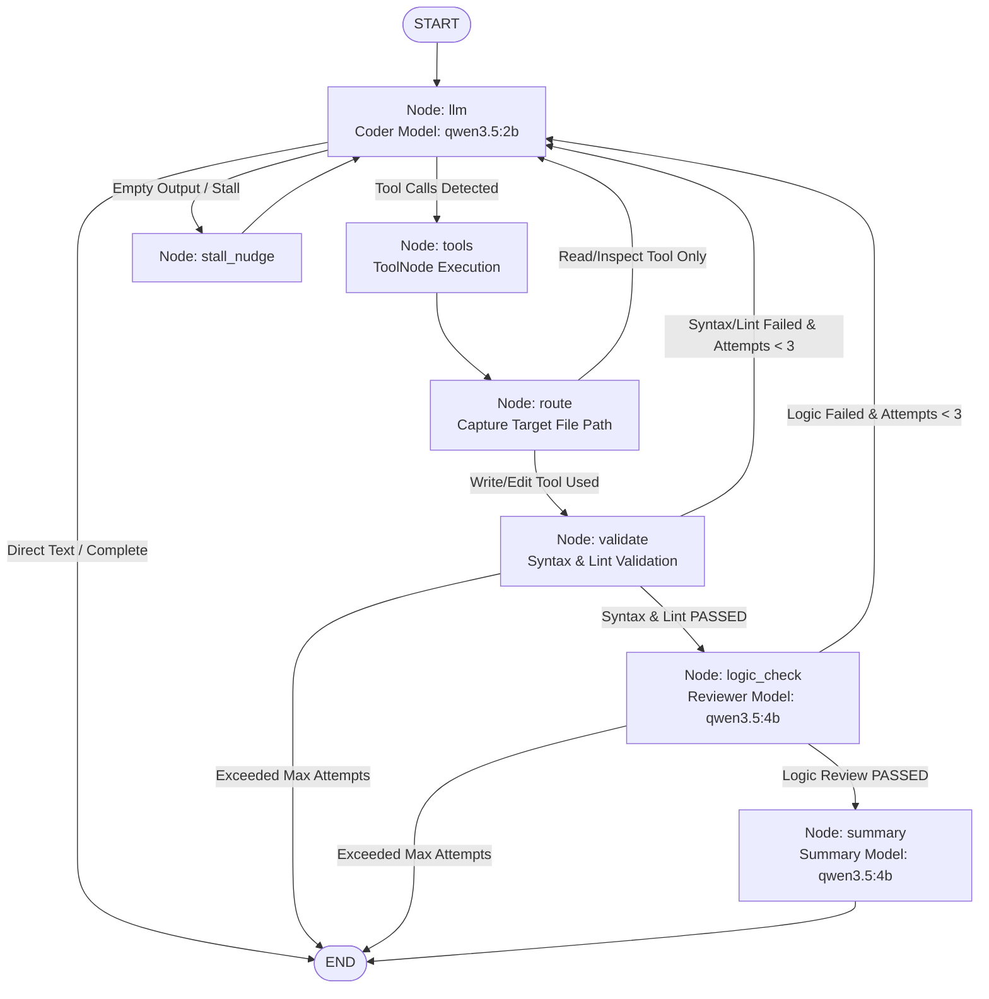

# Autonomous Self-Correcting Coding Agent

An autonomous, multi-agent coding system built with **LangGraph**, **LangChain**, and local LLMs via **Ollama**. The agent takes natural language programming tasks, writes code into a sandboxed project workspace, and runs it through an iterative, self-correcting validation pipeline (syntax checks, static linting, and LLM-based logic reviews) until the code is bug-free and verified.

---

## Table of Contents

- [Overview](#overview)
- [How It Works (Architecture & Flow)](#how-it-works-architecture--flow)
- [Models Used](#models-used)
- [Key Features](#key-features)
- [Project Structure](#project-structure)
- [Prerequisites](#prerequisites)
- [Installation & Setup](#installation--setup)
- [Running the Agent](#running-the-agent)
- [Configuration](#configuration)
- [Available Tools](#available-tools)

---

## Overview

Unlike standard one-shot code generation scripts, this agent operates within a **closed-loop feedback system**:

1. **Plans & Generates**: Uses a fast local model to inspect workspace files, plan, and write code.
2. **Compiles & Lints**: Automatically tests Python (`py_compile`, `pylint`) and JavaScript/TypeScript (`node --check`, `eslint`) code for syntax errors and fatal lint issues.
3. **Logic Review**: Employs a secondary reviewer LLM to verify whether the written code accurately fulfills the user's initial instructions.
4. **Self-Corrects**: When syntax, lint, or logic checks fail, precise diagnostic feedback is fed back to the coding model to rewrite the file (up to a maximum attempt limit).
5. **Summarizes**: Upon passing all gates, a summary model explains the implemented solution and concludes the workflow.
---
## How It Works (Architecture & Flow)

The agent is modeled as a cyclic state graph in **LangGraph** (`AgentState`):



### Detailed Flow Explanation

1. **`llm` (Generation Node)**:
   - Receives the system instructions and conversation history.
   - Invokes the primary model (`qwen3.5:2b`) with access to 8 file and command execution tools.
   - Streams reasoning and code tokens directly to the console.

2. **`stall_nudge` (Stall Guard Node)**:
   - If the model produces empty output without calling a tool or answering, it nudges the model to proceed with `write_project_file` (up to `MAX_STALLS = 3`).

3. **`tools` & `route` (Tool Execution & Path Interception)**:
   - Executes the selected tools via `ToolNode`.
   - `capture_write_path` detects whether a file was written or modified (`write_project_file` or `edit_project_file`).
   - If a file modification occurred, execution redirects to `validate`. If only inspection tools were used (e.g. read, list, search), control returns to `llm`.

4. **`validate` (Syntax & Static Analysis Node)**:
   - **Python (`.py`)**: Runs `python -m py_compile` followed by `pylint --output-format=json`.
   - **JavaScript/TypeScript (`.js`, `.jsx`, `.ts`, `.tsx`)**: Runs `node --check` followed by `npx --yes eslint -f json`.
   - If any errors exist, diagnostic reports are added to the state as a `SystemMessage` prompting a complete rewrite, and the graph loops back to `llm`.

5. **`logic_check` (Logic Verification Node)**:
   - Compares the written file against the original user prompt using the reviewer model (`qwen3.5:4b`).
   - The reviewer checks only functional correctness and returns either `PASS` or `FAIL: <description of bug>`.
   - On `FAIL`, feedback is sent back to the coding LLM for another iteration (up to `MAX_ATTEMPTS = 3`).

6. **`summary` (Completion Node)**:
   - Once all validations pass, the summary model produces a concise description of what was built and confirms task completion.

---

## Models Used

The project uses locally hosted models through **Ollama**:

| Role | Model Identifier | Context Window (`num_ctx`) | Max Tokens (`num_predict`) | Purpose |
| :--- | :--- | :--- | :--- | :--- |
| **Primary Coder** | `qwen3.5:2b` | 8,192 | 10,000 | Fast tool-calling agent responsible for planning, reading files, and writing code. Runs with `reasoning=True`. |
| **Code Reviewer** | `qwen3.5:4b` | 8,192 | 2,000 | Evaluates code against user requirements to catch logical flaws. |
| **Summarizer** | `qwen3.5:4b` | 8,192 | 10,000 | Produces the final completion summary for the user. |

> *Note: Model parameters (e.g., `num_gpu=999`) offload layers to available GPU acceleration in Ollama.*

---

## Key Features

- **Sandboxed Workspace**: All file modifications and command executions are restricted inside the designated `testing/workspace/` directory with path traversal protections (`_safe_path`).
- **Autonomous Error Correction**: Syntax errors (compilation errors), lint errors (Pylint / ESLint), and logical oversights trigger automatic re-prompts with exact error messages.
- **Loop Guards & Stall Prevention**:
  - `MAX_ATTEMPTS = 3`: Prevents infinite loops when a stubborn error cannot be fixed.
  - `MAX_STALLS = 3`: Rescues the model if it pauses or hallucinates blank steps without taking action.
- **Full Shell & Test Capabilities**: Agent can execute arbitrary workspace commands and run test suites via `pytest`.
- **Real-Time Streaming**: Streams LangGraph updates and model response tokens to stdout as they generate.

---

## Project Structure

```text
AGENTIC AI/
├── README.md                 # Project documentation
├── requirements.txt          # Python dependencies
└── testing/
    ├── agent.py              # Main LangGraph agent state graph & orchestration
    ├── file_tools.py         # Sandboxed workspace operations & tool definitions
    └── workspace/            # Sandboxed directory where code is read, written, and tested
```

---

## Prerequisites

1. **Python**: Version 3.10 or higher.
2. **Ollama**: Installed and running locally ([Download Ollama](https://ollama.com/)).
3. **Node.js & npm** (optional, for JS/TS linting): Used for `node --check` and `eslint`.
4. **Pylint** (for Python linting): Included in `requirements.txt`.

---

## Installation & Setup

### 1. Clone or Open the Repository
```bash
cd "AGENTIC AI"
```

### 2. Set Up a Virtual Environment
```bash
# Windows
python -m venv .venv
.venv\Scripts\activate

# macOS / Linux
python3 -m venv .venv
source .venv/bin/activate
```

### 3. Install Dependencies
```bash
pip install -r requirements.txt
```

### 4. Pull the Required Ollama Models
Ensure the Ollama service is active, then pull the required models:
```bash
ollama pull qwen3.5:2b
ollama pull qwen3.5:4b
```

*(If using alternative models, update `MODEL` and `REVIEW_MODEL` in `testing/agent.py`).*

---

## Running the Agent

Run the script from the project root or the `testing/` directory:

```bash
python testing/agent.py
```

### Example Usage Session

```text
Please enter your task: Write a Python script named fibonacci.py that calculates the first 10 Fibonacci numbers and prints them as a list.

[llm finished]
[tools finished]
[route finished]
[validate finished]
[logic_check finished]
[summary finished]

The file fibonacci.py was created and validated. It computes the first 10 Fibonacci numbers using an iterative approach and outputs [0, 1, 1, 2, 3, 5, 8, 13, 21, 34].

DONE
```

The generated code will be stored safely inside `testing/workspace/fibonacci.py`.

---

## Configuration

You can customize parameters directly at the top of `testing/agent.py`:

```python
MODEL = "qwen3.5:2b"          # Primary generator model
REVIEW_MODEL = "qwen3.5:4b"   # Reviewer and summarizer model
MAX_ATTEMPTS = 3              # Max self-correction attempts for lint/logic failures
MAX_STALLS = 3                # Max empty/idle model turns allowed before termination
```

---

## Available Tools

The agent has access to 8 sandboxed tools defined in `testing/file_tools.py`:

| Tool | Parameters | Description |
| :--- | :--- | :--- |
| `list_project_files` | None | Lists all files inside the `workspace/` folder (skipping `.git`, `node_modules`, `.venv`, etc.). |
| `search_project_files` | `query: str` | Searches for text across all non-binary files in the workspace. |
| `read_project_file` | `path: str` | Reads the full text contents of a target file. |
| `write_project_file` | `path: str, content: str` | Creates a new file or completely replaces the contents of an existing file. |
| `edit_project_file` | `path: str, old_text: str, new_text: str` | Performs an exact string replacement inside a file. |
| `delete_project_file` | `path: str` | Deletes a specified file from the workspace. |
| `execute_project_command` | `command: str` | Executes a shell command inside `workspace/` with a 60-second timeout. |
| `run_project_tests` | None | Executes `pytest` inside the workspace. |

